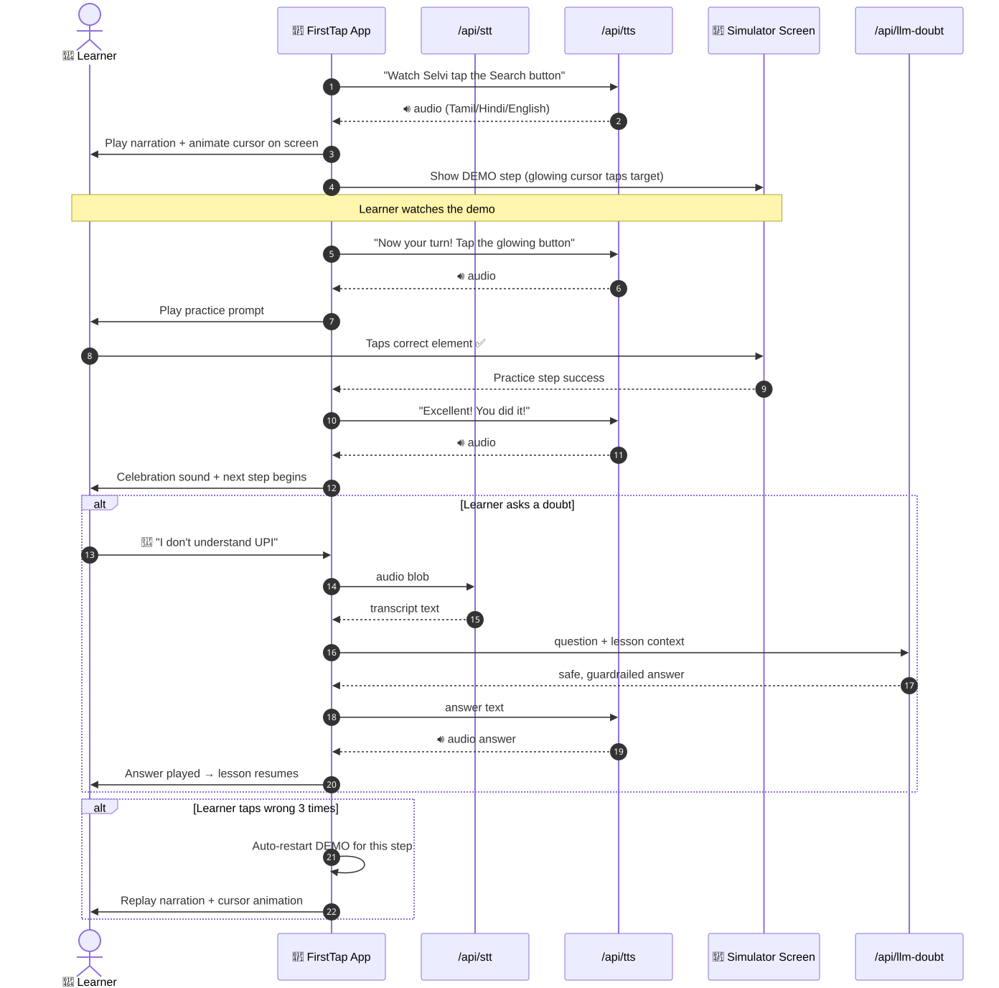
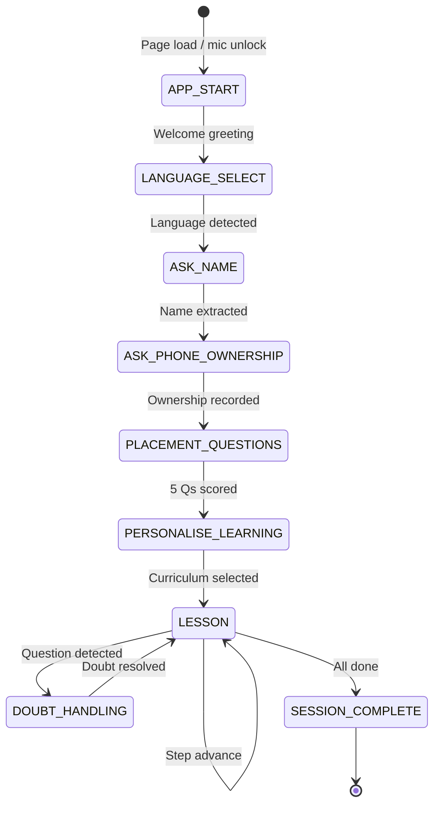

# FirstTap — Voice-First Digital Literacy Companion

<div align="center">

**Empowering first-time smartphone users in India through voice-guided micro-lessons**

[](https://firsttap-main.vercel.app)
[](./LICENSE)
[](https://nextjs.org)
[](https://www.typescriptlang.org)

🌐 **[https://firsttap-main.vercel.app](https://firsttap-main.vercel.app)**  
📖 **[Technical Design Document](./TECHNICAL_DESIGN.md)**  
📋 **[Test Cases](./src/lib/__tests__/sample-data.test.ts)**  

</div>

---

## 🗺️ Architecture

> **New here?** These five diagrams explain how FirstTap works — no technical background needed.

### 1. System Architecture — How everything connects



*The learner speaks into their phone → the Voice Engine records audio → it is transcribed by the Speech-to-Text API → the FSM decides what to say next → the Text-to-Speech API plays the response. Every API has a local browser fallback so the app works even without API keys.*

---

### 2. Voice Data Flow — What happens when a learner speaks



*From microphone to spoken response in under 2 seconds. The Voice Activity Detector stops recording after 1.8 s of silence so learners never need to press a button.*

---

### 3. Code Module Map — How the project is organised



*Each simulator module (WhatsApp, UPI, Phone Settings, Maps, Business) is self-contained. They all share the FSM core and Voice Engine from `src/lib/`.*

---

### 4. Deployment — How code reaches production



*A `git push` to `main` triggers an automatic Vercel build. Secret API keys are injected at build time from the Vercel dashboard and never leave the server.*

---

### 5. Lesson Sequence — The most important workflow



*Every lesson follows the same loop: Selvi narrates → animated cursor shows the tap → learner practices → success triggers the next step. If the learner taps wrong 3 times, the demo restarts automatically. Mid-lesson doubts are handled by a guardrailed Gemini LLM.*

---


## 🎯 What is FirstTap?

**FirstTap** is a voice-first digital literacy app designed for first-time smartphone users in rural and semi-urban India — people who may not read well but deserve access to the digital economy.

A friendly AI mentor named **Selvi** walks learners through practical skills:

| Module | What Learners Learn |
|--------|---------------------|
| 📱 WhatsApp | Send messages, add contacts, make voice calls |
| 💳 UPI Safety | Identify collect-request fraud, never enter PIN to "receive" |
| ⚙️ Phone Settings | Mobile data, Wi-Fi, torch, hotspot, silent mode |
| 🗺️ Google Maps | Search places, get directions, navigate |
| 🏪 WhatsApp Business | Set up catalog, reply to customers |
| 🛡️ Spam / Fraud Defence | Detect phishing SMS, block & report |

**Languages**: Tamil 🇮🇳 · Hindi 🇮🇳 · English  
**No reading required**: Every step narrated in the learner's mother tongue.

---

## 🌟 Key Features

- **Voice-First Experience** — entire lesson flow navigable by speech alone
- **Deterministic FSM** — conversation never drifts; resumes exactly after interruptions
- **Interactive Phone Simulators** — tap the simulated phone screen to practice safely
- **Multilingual TTS/STT** — Sarvam AI Bulbul (TTS) + Saaras (STT) for authentic Indian accents
- **Graceful Fallback** — works 100% offline-API using browser Web Speech API
- **Cyber Fraud Guard** — LLM system prompt hard-blocks PIN/OTP/password advice
- **Ask Selvi (LLM Doubt)** — learners can ask any question mid-lesson, answered safely via Gemini

---

## 🛠️ Technology Stack

| Layer | Technology |
|-------|-----------|
| Framework | Next.js 16 (App Router, Turbopack) |
| Language | TypeScript 5 |
| Styling | Tailwind CSS v4 |
| Animation | Framer Motion + Canvas Confetti |
| Speech STT | Sarvam AI Saaras v1 → Browser fallback |
| Speech TTS | Sarvam AI Bulbul v1 → SpeechSynthesis fallback |
| LLM | Google Gemini 1.5 Flash |
| Auth / DB | Firebase (Firestore + Auth) |
| Hosting | Vercel |
| Testing | Node.js built-in test runner + tsx |

---

## 🚀 Getting Started

### Prerequisites
- **Node.js 18+** (tested on v24)
- **npm 9+**
- Chrome or Edge (recommended for full microphone + Web Speech support)

### 1. Clone the Repository

```bash
git clone https://github.com/harikrishnan2201/Firsttapdemo.git
cd Firsttapdemo
npm install
```

### 2. Set Up Environment Variables

```bash
cp .env.example .env.local
```

Open `.env.local` and fill in your keys:

```env
# ── Sarvam AI (Indian-language STT + TTS) ──────────────────────────────────
# Get your key at: https://dashboard.sarvam.ai
# If blank → browser Web Speech API fallback (app fully works without this)
SARVAM_API_KEY=your_sarvam_api_key_here

# ── Google Gemini (LLM Doubt Resolution) ───────────────────────────────────
# Get your key at: https://aistudio.google.com/app/apikey
# If blank → built-in verified cybersecurity answer engine
GEMINI_API_KEY=your_gemini_api_key_here

# ── Application Metadata ───────────────────────────────────────────────────
NEXT_PUBLIC_APP_NAME=FirstTap

# ── Firebase (User Profiles + Progress Tracking) ───────────────────────────
# From: Firebase Console → Project Settings → General → Your apps → Web app
# Optional: omit to disable profile/progress persistence
NEXT_PUBLIC_FIREBASE_API_KEY=your_firebase_api_key_here
NEXT_PUBLIC_FIREBASE_AUTH_DOMAIN=your_project_id.firebaseapp.com
NEXT_PUBLIC_FIREBASE_PROJECT_ID=your_project_id
NEXT_PUBLIC_FIREBASE_STORAGE_BUCKET=your_project_id.firebasestorage.app
NEXT_PUBLIC_FIREBASE_MESSAGING_SENDER_ID=your_messaging_sender_id
NEXT_PUBLIC_FIREBASE_APP_ID=your_firebase_app_id
NEXT_PUBLIC_FIREBASE_MEASUREMENT_ID=your_measurement_id
```

> **Demo Mode**: All API keys are optional. When omitted, FirstTap uses browser-native speech synthesis and a built-in cybersecurity answer engine — fully functional for evaluation without any API charges.

### 3. Run the Development Server

```bash
npm run dev
```

Open [http://localhost:3000](http://localhost:3000) in Chrome or Edge.

### 4. Build for Production

```bash
npm run build
npm start
```

### 5. Deploy to Vercel

```bash
npx vercel --prod
```

Set the environment variables in your Vercel project dashboard before deploying:  
**Vercel Dashboard → Project → Settings → Environment Variables**

---

## 🧪 Running Tests

### FSM Unit Tests (Core State Machine)
```bash
npx -y tsx src/lib/fsm/__tests__/fsm.test.ts
```

Validates:
- Language intent matching (Tamil, Hindi, English)
- Name extraction from conversational phrases
- Affirmative / negative intent
- Placement progression + literacy level scoring
- Doubt interruption + step resumption

### Sample Data & Integration Test Cases
```bash
npx -y tsx src/lib/__tests__/sample-data.test.ts
```

Covers 30+ test cases across:
- Language detection
- Name extraction
- UPI fraud flag detection
- WhatsApp lesson step validation
- API response shape contracts

---

## 📁 Project Structure

```
Firsttapdemo/
├── src/
│   ├── app/
│   │   ├── api/
│   │   │   ├── llm-doubt/route.ts    # Gemini LLM doubt resolution (guardrailed)
│   │   │   ├── stt/route.ts          # Sarvam Saaras STT + browser fallback
│   │   │   ├── tts/route.ts          # Sarvam Bulbul TTS + SpeechSynthesis fallback
│   │   │   ├── health/route.ts       # Uptime health check
│   │   │   └── profile/route.ts      # User profile save/load
│   │   ├── globals.css               # Tailwind CSS v4 global styles
│   │   ├── layout.tsx                # Root layout + Outfit font
│   │   └── page.tsx                  # Main voice interface + simulator router
│   ├── components/
│   │   ├── Captions.tsx              # Accessible live subtitles
│   │   ├── ControlBar.tsx            # Voice dock + accessible controls
│   │   ├── Header.tsx                # Language switcher + status badge
│   │   ├── LessonInteractive.tsx     # Simulator launcher
│   │   ├── Mascot.tsx                # Animated SVG mentor (Tapu)
│   │   ├── PermissionModal.tsx       # Welcome + mic permission screen
│   │   ├── VoiceVisualizer.tsx       # Reactive audio waveform
│   │   ├── whatsapp/                 # WhatsApp simulator + lessons
│   │   │   ├── FirstTapWhatsApp.tsx  # Main 3-row layout shell
│   │   │   ├── DemoRunnerOverlay.tsx # Animated Selvi cursor
│   │   │   ├── PracticeSpotlightOverlay.tsx
│   │   │   ├── AskSelviModal.tsx     # Mid-lesson doubt modal
│   │   │   └── WhatsAppTutorialScreen.tsx
│   │   ├── spam/                     # UPI + SMS fraud simulators
│   │   │   ├── MessageSimulator.tsx  # SMS phishing drill
│   │   │   ├── UpiSimulator.tsx      # UPI collect-request fraud drill
│   │   │   └── SpamPathScreen.tsx    # Fraud defence learning path
│   │   ├── phone-settings/           # Phone settings simulator (5 lessons + quiz)
│   │   │   └── PhoneSettingsSimulatorScreen.tsx
│   │   └── business/                 # Business / entrepreneur simulators
│   │       ├── maps-simulator/       # Google Maps navigation drill
│   │       └── whatsapp-business/    # WhatsApp Business setup drill
│   └── lib/
│       ├── fsm/
│       │   ├── __tests__/fsm.test.ts # Core FSM unit tests
│       │   ├── intents.ts            # Speech intent NLP
│       │   └── machine.ts            # Typed Finite State Machine
│       ├── __tests__/
│       │   └── sample-data.test.ts   # Sample data + integration test cases
│       ├── lessons/catalog.ts        # Curriculum + lesson data
│       └── voice/engine.ts           # VAD + MediaRecorder + audio pipeline
├── public/                           # Static assets (avatars, icons)
├── .env.example                      # Environment variable template
├── TECHNICAL_DESIGN.md               # Architecture + design document
├── LICENSE                           # MIT License
├── AGENTS.md                         # AI coding agent guidelines
├── next.config.ts
├── tsconfig.json
└── package.json
```

---

## 📋 Conversation Flow



---

## 🔒 Security & Privacy

- **No raw audio stored** — voice blobs processed in-memory, never persisted
- **LLM guardrails** — system prompt forbids PIN, OTP, password, or bank-detail advice
- **Server-side keys only** — `SARVAM_API_KEY` and `GEMINI_API_KEY` never reach the client bundle
- **Safe fallback** — API failures handled gracefully; FSM continues with deterministic answers

---

## 📚 Documentation

| Document | Description |
|----------|-------------|
| [TECHNICAL_DESIGN.md](./TECHNICAL_DESIGN.md) | Architecture diagrams, API docs, FSM design, security design |
| [AGENTS.md](./AGENTS.md) | AI coding agent guidelines for this repository |
| [.env.example](./.env.example) | All environment variable definitions with comments |
| [src/lib/__tests__/](./src/lib/__tests__/) | Test suites and sample data |

---

## 🤝 Contributing

1. Fork the repository
2. Create your feature branch: `git checkout -b feature/my-new-lesson`
3. Follow the patterns in `AGENTS.md`
4. Run `npx tsc --noEmit` before committing
5. Open a Pull Request

---

## 📜 License

This project is licensed under the **MIT License** — see the [LICENSE](./LICENSE) file for details.

---

<div align="center">
Built with ❤️ for digital inclusion in India · FirstTap 2024
</div>
