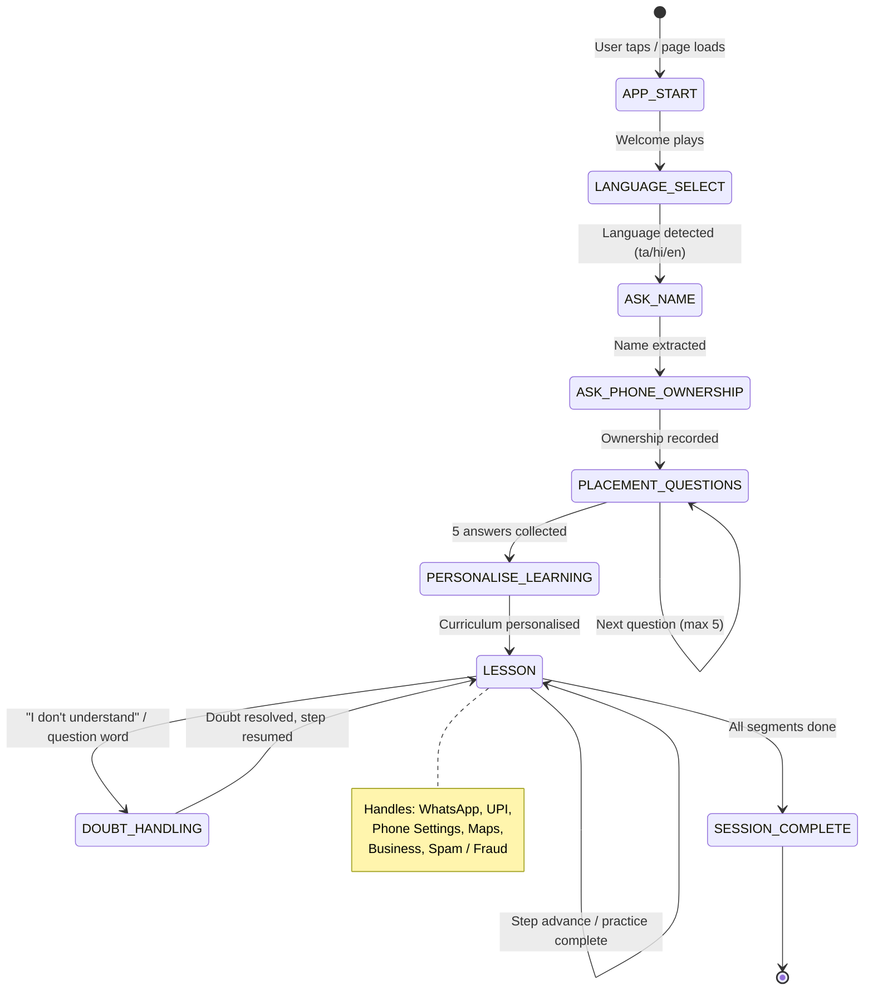
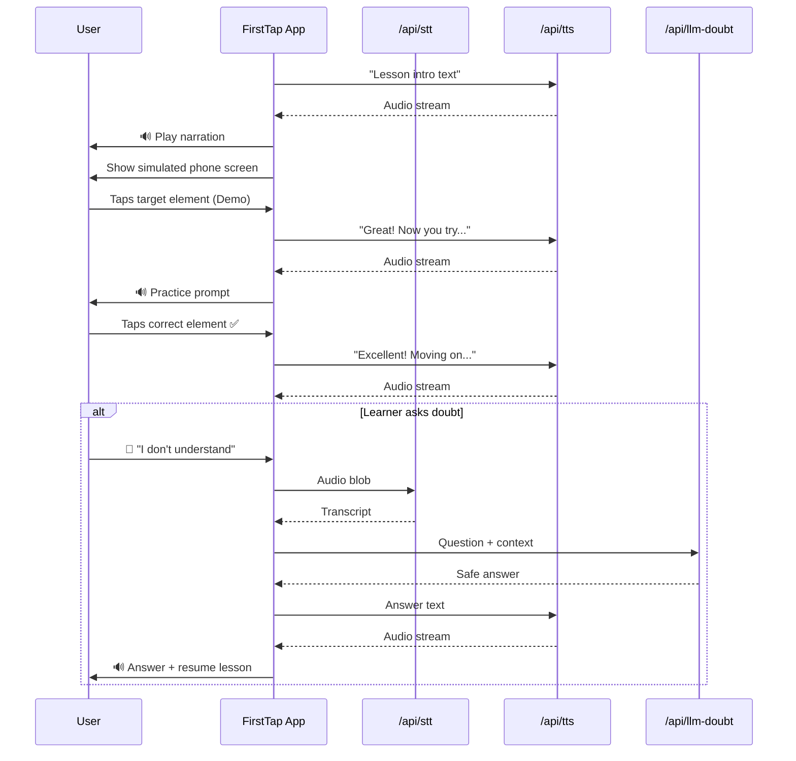

# FirstTap — Technical Design Document

**Version**: 2.0  
**Author**: Harikrishnan R  
**Repository**: https://github.com/harikrishnan2201/Firsttapdemo  
**Live Demo**: https://firsttap-main.vercel.app  

---

## 1. Project Overview

FirstTap is a **voice-first digital literacy companion** for first-time smartphone users in rural and semi-urban India. The system teaches WhatsApp, UPI payments, phone settings, Maps navigation, and cyber-fraud defence through interactive voice-guided micro-lessons in Tamil, Hindi, and English.

### Design Goals
| Goal | Approach |
|------|----------|
| Zero literacy required | Every step narrated; no reading needed |
| Works on 2G / low bandwidth | Graceful fallback to browser Web Speech API |
| Never crashes on API failure | Deterministic FSM + local fallbacks |
| Teachable in < 5 min per lesson | Micro-lesson segments with practice prompts |
| Multilingual | Tamil (primary), Hindi, English |

---

## 2. High-Level Architecture

```
┌─────────────────────────────────────────────────────────────┐
│                     User's Browser                          │
│  ┌──────────────┐  ┌────────────────┐  ┌────────────────┐  │
│  │  Microphone  │  │  Speaker/TTS   │  │  Touch Screen  │  │
│  └──────┬───────┘  └───────▲────────┘  └───────┬────────┘  │
│         │ MediaRecorder     │ AudioBuffer        │ Events    │
│  ┌──────▼───────────────────┴────────────────────▼────────┐ │
│  │              Next.js App (React + TypeScript)           │ │
│  │  ┌──────────┐ ┌──────────┐ ┌──────────┐ ┌──────────┐  │ │
│  │  │  Voice   │ │ FSM Core │ │Simulators│ │  Mascot  │  │ │
│  │  │ Engine   │ │(machine) │ │(WA/UPI/  │ │  (Tapu)  │  │ │
│  │  │          │ │          │ │Settings/ │ │          │  │ │
│  │  │          │ │          │ │Maps/Biz) │ │          │  │ │
│  │  └────┬─────┘ └────┬─────┘ └──────────┘ └──────────┘  │ │
│  └───────┼────────────┼──────────────────────────────────┘ │
└──────────┼────────────┼────────────────────────────────────┘
           │ fetch       │ state
┌──────────▼────────────▼────────────────────────────────────┐
│                  Next.js API Routes                         │
│  ┌──────────────┐  ┌──────────────┐  ┌───────────────────┐ │
│  │  /api/stt    │  │  /api/tts    │  │  /api/llm-doubt   │ │
│  │ (Sarvam STT) │  │ (Sarvam TTS) │  │ (Gemini LLM)      │ │
│  └──────┬───────┘  └──────┬───────┘  └────────┬──────────┘ │
└─────────┼────────────────┼───────────────────┼────────────┘
          │                │                   │
┌─────────▼────────────────▼───────────────────▼────────────┐
│                  External Services                          │
│   Sarvam AI (Saaras v1 STT + Bulbul v1 TTS)   Google Gemini│
└─────────────────────────────────────────────────────────────┘
```

---

## 3. Core FSM (Finite State Machine)

The conversation engine is a **typed, deterministic FSM** in `src/lib/fsm/machine.ts`.

### State Diagram



### State Definitions
| State | Responsibility |
|-------|---------------|
| `APP_START` | Audio context unlock, mic permission request |
| `LANGUAGE_SELECT` | Plays trilingual greeting, detects spoken language |
| `ASK_NAME` | Extracts learner's name using NLP intent matching |
| `ASK_PHONE_OWNERSHIP` | Classifies beginner / intermediate / advanced |
| `PLACEMENT_QUESTIONS` | 5 adaptive questions; scores literacy level 0–5 |
| `PERSONALISE_LEARNING` | Selects curriculum path based on score |
| `LESSON` | Interactive simulator + voice narration loop |
| `DOUBT_HANDLING` | Routes question to Gemini LLM, returns answer |
| `SESSION_COMPLETE` | Celebration + summary |

---

## 4. Voice Engine

**File**: `src/lib/voice/engine.ts`

### Audio Pipeline

```
Mic Input
  │
  ▼
MediaRecorder (Opus/WebM or MP4 on iOS)
  │
  ├──► AudioContext Analyser ──► VAD (silence detection ~1.8s)
  │
  ▼
Blob → FormData → POST /api/stt
  │
  ├── [Has SARVAM_API_KEY] → Sarvam Saaras v1 (Indian-accent STT)
  └── [No key / error]    → Browser webkitSpeechRecognition fallback
  │
  ▼
Transcript → FSM intent matching
  │
  ▼
Response text → POST /api/tts
  │
  ├── [Has SARVAM_API_KEY] → Sarvam Bulbul v1 (Natural Indian TTS)
  └── [No key / error]    → window.speechSynthesis fallback
  │
  ▼
Audio playback → AudioContext
```

### VAD (Voice Activity Detection) Parameters
| Parameter | Value | Reason |
|-----------|-------|--------|
| Silence threshold | 15 (RMS) | Low enough for noisy environments |
| Silence timeout | 1800 ms | Comfortable pause for elderly users |
| Max recording | 30 000 ms | Prevents infinite loops |
| Sample rate | 16 000 Hz | Optimal for speech STT |

---

## 5. Simulator Architecture

Each module simulator follows an identical pattern:

```
Parent Screen (e.g., FirstTapWhatsApp.tsx)
  │
  ├── Row 1 (shrink-0): Top control bar + Nav bar + Demo/Practice bar
  ├── Row 2 (flex-1):   Simulated phone screen viewport
  │     ├── DemoRunnerOverlay    (cursor animation, dims screen)
  │     ├── PracticeSpotlightOverlay (spotlight ring on target)
  │     └── Active screen component (CHAT_LIST / MESSAGE_VIEW / etc.)
  └── Row 3 (shrink-0): Selvi guidance box (voice transcript)
```

### Simulator Modules
| Module | Path | Screens / Lessons |
|--------|------|-------------------|
| WhatsApp | `src/components/whatsapp/` | Chat list, Message, New contact, Call |
| UPI / Spam | `src/components/spam/` | UPI collect fraud, SMS phishing |
| Phone Settings | `src/components/phone-settings/` | Data, Torch, Wi-Fi, Hotspot, Silent + Quiz |
| Google Maps | `src/components/business/maps-simulator/` | Search, Navigate, Directions |
| WhatsApp Business | `src/components/business/whatsapp-business/` | Catalog, Orders, Replies |

---

## 6. API Routes

### `POST /api/stt`
Transcribes audio to text using Sarvam Saaras v1.

**Request**: `multipart/form-data` with `audio` (Blob) + `language` (`ta-IN` / `hi-IN` / `en-IN`)  
**Response**: `{ transcript: string, confidence: number }`  
**Fallback**: Returns `{ transcript: "" }` if API fails — FSM retries gracefully.

### `POST /api/tts`
Synthesises speech using Sarvam Bulbul v1.

**Request**: `{ text: string, language: "ta-IN" | "hi-IN" | "en-IN", voice?: string }`  
**Response**: `audio/mpeg` stream  
**Fallback**: Returns 204 — client uses `window.speechSynthesis`.

### `POST /api/llm-doubt`
Routes learner doubts to Google Gemini with a strict cybersecurity system prompt.

**Request**: `{ question: string, language: "ta" | "hi" | "en", context?: string }`  
**Response**: `{ answer: string }`  
**Guardrails**: System prompt forbids advice on sharing OTPs, PINs, passwords, or bank details.

### `GET /api/health`
Returns `{ status: "ok", timestamp }` — used for uptime monitoring.

---

## 7. Data Flow: Lesson Execution



---

## 8. Security Design

| Threat | Mitigation |
|--------|-----------|
| Financial fraud via LLM | System prompt hard-blocks PIN/OTP/password advice |
| Audio data leakage | Audio blobs processed in memory; never stored |
| API key exposure | All keys server-side only; never in client bundle |
| XSS | Next.js automatic escaping; no `dangerouslySetInnerHTML` |
| CORS abuse | API routes validate `Content-Type` and origin headers |

---

## 9. Deployment Architecture

```
Developer Machine
      │
      │ git push origin main
      ▼
GitHub (harikrishnan2201/Firsttapdemo)
      │
      │ Webhook trigger
      ▼
Vercel (Auto-deploy)
      │
      ├── Build: next build (Turbopack)
      ├── Env: SARVAM_API_KEY, GEMINI_API_KEY, FIREBASE_* (set in Vercel dashboard)
      └── CDN: https://firsttap-main.vercel.app
```

### Environment Variables (Vercel)
| Variable | Required | Purpose |
|----------|----------|---------|
| `SARVAM_API_KEY` | Optional | Indian-language STT + TTS |
| `GEMINI_API_KEY` | Optional | LLM doubt resolution |
| `NEXT_PUBLIC_FIREBASE_API_KEY` | Optional | User profiles / progress |
| `NEXT_PUBLIC_FIREBASE_PROJECT_ID` | Optional | Firestore DB |
| `NEXT_PUBLIC_APP_NAME` | No | Displayed app name |

---

## 10. Performance Targets

| Metric | Target | Achieved By |
|--------|--------|-------------|
| First Contentful Paint | < 1.5s | Static page + CDN edge |
| Time to Interactive | < 3s | Code splitting per simulator |
| Audio latency (TTS) | < 800ms | Streaming audio response |
| STT round-trip | < 1.5s | Direct Sarvam API call |
| Bundle size | < 500 KB gzipped | Tree-shaking + Turbopack |

---

*Document maintained alongside code. Update when adding new simulator modules or API endpoints.*
